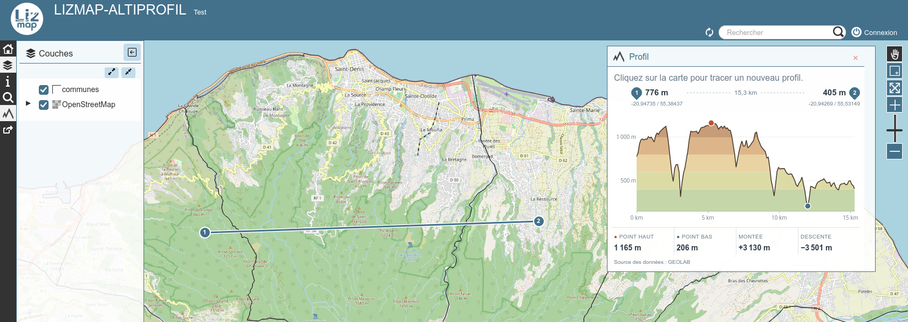
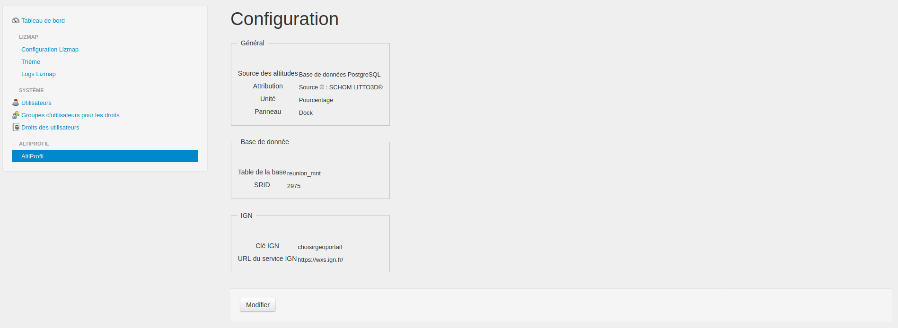

# AltiProfil for Lizmap

[](https://packagist.org/packages/arno974/lizmap-altiprofil)

## Description

This Lizmap client module draws an **elevation profile** between two points clicked on the map. Elevations come either from a raster table stored in **PostGIS** (DEM) or from the "IGN" altimetry API.



### Features

* Elevation of each clicked point.
* Profile chart with a filled terrain area.
* Highest and lowest points highlighted on the chart.
* Cumulative elevation gain and loss (D+ / D-).
* Hovering the chart shows the matching location on the map.
* With the **database** provider only:
  * slope along the profile, in percent or degrees, shown in the tooltip, with min / max / mean values;
  * sampling resolution shown in the chart title;
  * per-project override of the DEM table (see [Override the configuration for a single project](#override-the-configuration-for-a-single-project)).
* Translations: English, French, German, Portuguese, Romanian.


## Installation

Use minimum version 0.5.0 with Lizmap 3.8

[Version 0.4.2](https://github.com/arno974/lizmap-altiProfil/releases/tag/0.4.2) is compatible with Lizmap Web Client 3.4 and < 3.8.

You should install it with [Composer](https://getcomposer.org).
If you can't, you must follow the **manual installation** part.

### With Composer

* In `lizmap/my-packages`, create the file `composer.json` if it doesn't exist by copying
  the file `composer.json.dist`. Then launch Composer by specifying the module name to install.

```bash
cp -n lizmap/my-packages/composer.json.dist lizmap/my-packages/composer.json
composer require --working-dir=lizmap/my-packages "arno974/lizmap-altiprofil"
```

* Then go in `lizmap/install/` and execute some scripts :

```bash
  php configurator.php altiProfil
  php configurator.php altiProfilAdmin
  php installer.php
  ./clean_vartmp.sh
  ./set_rights.sh
```

Go to the configuration part.

### Manual installation

* Download the ZIP from the [GitHub release page](https://github.com/arno974/lizmap-altiProfil/releases).
* Extract the zip and copy directories `altiProfil` and `altiProfilAdmin`
  in folder `lizmap/lizmap-modules/`
* Modules need to be enabled in Lizmap by editing the configuration file `lizmap/var/config`.


Then run the same `configurator.php`, `installer.php`, `clean_vartmp.sh` and `set_rights.sh` commands as above, from the `lizmap/install/` directory.

```ini
[modules]

altiProfil.access=2
altiProfilAdmin.access=2
```

For Lizmap 3.6 or higher, don't modify `lizmap/var/config/localconfig.ini.php`, launch this command instead:

```
php lizmap/install/configurator.php altiProfil
php lizmap/install/configurator.php altiProfilAdmin
```


* Then for any version of Lizmap, launch the installation of the modules with

```bash
php lizmap/install/installer.php
lizmap/install/clean_vartmp.sh
lizmap/install/set_rights.sh
```

## Configuration

Open the Lizmap administration panel to set up the module.



This configuration will create or edit the file `lizmap/var/config/altiProfil.ini.php`, which might contain for instance :

```ini
[altiProfil]
altisource=Source of data

;if database
altiProfileProvider=database
altiProfileSchema=dem_schema
altiProfileTable=dem_table
srid=3857
; profilUnit = PERCENT or DEGREES - unit for the profil
profilUnit= PERCENT
; dock panel = dock or minidock or rightdock
dock=dock
altiresolution=10

;if IGN French data provider
;altiProfileProvider= ign
```

| Key | Values | Default | Description |
|-----|--------|---------|-------------|
| `altiProfileProvider` | `ign`, `database` | `ign` | Elevation source. |
| `altisource` | text | empty | Data source, displayed under the chart. HTML tags are not allowed. |
| `profilUnit` | `PERCENT`, `DEGREES` | `PERCENT` | Slope unit (database provider only). |
| `dock` | `dock`, `minidock`, `rightdock` | `dock` | Where the tool is displayed. |
| `altiProfileSchema` | `[a-zA-Z0-9_]+` | empty | Schema of the raster table. |
| `altiProfileTable` | `[a-zA-Z0-9_]+` | empty | Raster table. |
| `srid` | integer | `3857` | SRID of the raster table. |
| `altiresolution` | number > 0 | `25` | Sampling step of the profile, in raster units (usually the DEM resolution, in meters). |

### IGN French provider

_French only 🇫🇷_

```ini
altiProfileProvider=ign
```

No API key is needed. The module calls the public IGN Géoplateforme service
(`https://data.geopf.fr/altimetrie/1.0/calcul/alti/rest`) with the `ign_rge_alti_wld` resource.
The URL is built into the module and cannot be changed.

### Database provider

```ini
altiProfileProvider=database
```

The database provider requires **PostGIS 3.2 or higher** with the raster extension activated (bilinear interpolation of `ST_Value`).

#### Database connection

Add a `jdb:altiProfil` profile in `lizmap/var/config/profiles.ini.php`:

```ini
[jdb:altiProfil]
driver=pgsql
database=name of the database
host=localhost
port=5432
user=login
password=password
```

#### Raster table

The table must contain a raster column named `rast`, for instance loaded with `raster2pgsql`.
Set `srid` to the SRID of this raster.

A spatial index on the **convex hull** of the tiles is strongly recommended. The queries are written
to use it, and without it every profile scans all the tiles:

```sql
CREATE INDEX ON dem_schema.dem_table USING gist (ST_ConvexHull(rast));
ANALYZE dem_schema.dem_table;
```

## Override the configuration for a single project

For every project published in Lizmap, for instance `my_project.qgs`, you can add a new file with extension `.alti` at the end of the file.
In our example, it would be `my_project.qgs.alti`.

This file allows you to override schema, table, srid, etc. settings (when altiProfil is configured to use database as data source).

For instance

```ini
[altiProfil]
altiProfileSchema=srtm
altiProfileTable=srtm_paris_high_resolution
```

## Development

### Unit tests

```bash
composer install
vendor/bin/phpunit
```

The tests cover `AltiConfig`, `ProfileParams` and `ProviderFactory`.

### Test stack

The `tests/` directory contains a Docker Compose stack (Lizmap 3.9, QGIS Server, PostGIS) with a
sample project and an extract of the RGE ALTI 5m DEM. See [tests/README.md](tests/README.md).
